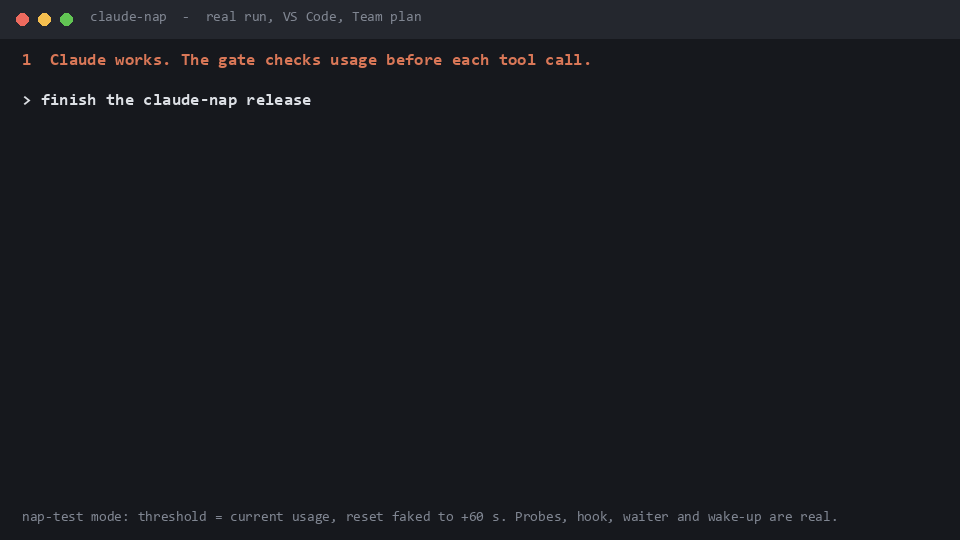
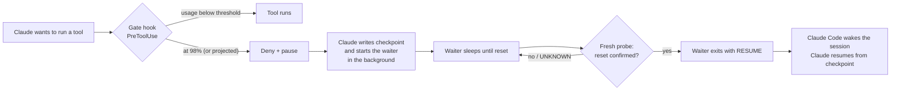

# claude-nap 💤

**Stop babysitting your Claude limit.** Claude naps at 98%, sleeps through the reset, and
picks up exactly where it left off.




Pause Claude Code before it runs into the claude.ai **5-hour usage limit**, then resume the
same task automatically after the reset, with no manual check-ins.

- Stops at a configurable threshold (default **98%**). It blocks the *next* tool call, so
  a running command or file write is never cut off.
- Also guards **subagent-heavy sessions**: it polls more often as usage rises, stops early
  when the burn rate predicts a crossing, and blocks new subagent fan-out from 90%.
- After the reset, a background waiter **confirms the reset with fresh data** before it wakes
  the session. A timer alone is never trusted.
- Built on hooks and background commands. The full pause → wait → resume cycle has been run for real
  in the **VS Code extension** on a **Team** plan (see the GIF). The CLI uses the same hooks and
  background commands. It should work on Pro and Max too.
- Never reads your OAuth token, never calls undocumented web endpoints, and never switches you to API
  billing. Usage it can't verify is reported as `UNKNOWN`, never guessed.

```powershell
irm https://raw.githubusercontent.com/NawrizTurjo/claude-nap/main/setup.ps1 | iex
```

> Windows + PowerShell 7 only, for now. Not affiliated with Anthropic.

---

## How it works



| Part | File | What it does |
|---|---|---|
| Usage probe | `ClaudeUsageManager.psm1` | Runs one tiny Haiku turn through `claude -p --output-format stream-json` and reads the `rate_limit_event` it emits: 5-hour `utilization` and `resetsAt`. |
| Usage check | `Check-ClaudeUsage.ps1` | Prints used %, remaining %, reset time (local), time to reset, data source, check time. |
| Gate | `hooks/UsageGate.ps1` | `PreToolUse` hook for every tool, in every session and subagent. Decides allow / deny. |
| Waiter | `Wait-ClaudeReset.ps1` | Started by Claude as a background command. Its exit re-invokes the session that started it. |
| Skill | `SKILL.md` | Tells Claude how to checkpoint, pause and resume without duplicating work. |

### Where the numbers come from

Claude Code emits a `rate_limit_event` message in `stream-json` output (type
`SDKRateLimitEvent` in the Agent SDK message union):

```json
{"type":"rate_limit_event","rate_limit_info":{"status":"allowed","resetsAt":1792513800,
 "rateLimitType":"five_hour","unifiedWindows":{"five_hour":{"utilization":0.47,"resetsAt":1792513800}}}}
```

The event type is part of the SDK, but its fields aren't documented in detail. So every
reading is validated: numeric, in range, reset in the future and within 5 hours, fresh,
subscription auth. Anything else becomes `UNKNOWN`.

Other sources were tested and rejected:

| Source | Why not |
|---|---|
| Status line `rate_limits.five_hour` | Documented only for Pro/Max; only updates while an interactive session is active. |
| `claude -p "/usage"` | Free, but on a Team account it returned a stale percentage (19% while the real value was 46%), and its structured `limits` field was `null`. |
| `api.anthropic.com/api/oauth/usage` | Undocumented, and needs your OAuth token. |

**Cost:** each probe is about 1.1k Haiku tokens on your subscription, roughly $0.0002 at
list price. Probes happen only while tools are being called, at the dynamic interval below.

### Dynamic polling

| 5-hour usage | Probe at most every |
|---|---|
| < 50% | 300 s |
| 50–75% | 120 s |
| 75–85% | 60 s |
| 85–92% | 20 s |
| ≥ 92% | 8 s |

When usage is climbing, the interval shrinks to a quarter of the projected time-to-threshold
(minimum 5 s). With `PredictiveStop`, the gate stops early if `used + burn rate × interval`
would reach the threshold. Parallel subagents share one cached reading through a lock file,
so only one of them probes at a time.

---

## Requirements

- Windows 10/11, [PowerShell 7](https://learn.microsoft.com/powershell/scripting/install/installing-powershell-on-windows) (`pwsh`)
- Claude Code CLI on `PATH`, signed in with a **claude.ai subscription** (not an API key):
  ```powershell
  irm https://claude.ai/install.ps1 | iex
  claude          # then /login with your Claude account, /status to confirm
  ```
- `ANTHROPIC_API_KEY` must **not** be set. The probe refuses to run if it is, because the
  probe would then be billed to the API.

## Install

One line, in PowerShell:

```powershell
irm https://raw.githubusercontent.com/NawrizTurjo/claude-nap/main/setup.ps1 | iex
```

This downloads the latest release to `%LOCALAPPDATA%\claude-nap` and installs it in
**dry-run** mode, which warns but never blocks. Run the same line again to update; your
`config.local.json` and `state\` are kept.

Then try a real pause/resume (about 2 minutes) and turn on blocking:

```powershell
pwsh -File "$env:LOCALAPPDATA\claude-nap\Start-NapTest.ps1"
pwsh -File "$env:LOCALAPPDATA\claude-nap\Install.ps1" -Enforce
```

Or install with blocking already on:

```powershell
& ([scriptblock]::Create((irm https://raw.githubusercontent.com/NawrizTurjo/claude-nap/main/setup.ps1))) -Enforce
```

<details>
<summary>Manual install (git clone)</summary>

```powershell
git clone https://github.com/NawrizTurjo/claude-nap.git
cd claude-nap
pwsh -File .\Check-ClaudeUsage.ps1        # confirm the reading matches claude.ai/settings/usage
pwsh -File .\tests\Test-UsageCheck.ps1    # simulated tests (no Claude calls)
pwsh -File .\tests\Test-Manager.ps1
pwsh -File .\Install.ps1                  # dry-run
pwsh -File .\Install.ps1 -Enforce         # writes "DryRun": false to config.local.json
```
</details>
`Install.ps1` backs up `~/.claude/settings.json`, then adds one `PreToolUse` hook. It also
links this folder as the skill `~/.claude/skills/claude-nap`. Restart open
Claude Code sessions afterwards.

When the dry-run warnings look right, turn on enforcement:

```powershell
pwsh -File .\Install.ps1 -Enforce     # writes "DryRun": false to config.local.json
```

## Try it in 2 minutes

Watch a real pause and resume without waiting hours for a real reset:

```powershell
pwsh -File .\Start-NapTest.ps1       # stop threshold = your current usage, fake reset in 60 s
```

Then ask Claude for any small task. The next tool call is denied; Claude writes a
checkpoint, starts the waiter in the background and stops. About 90 s later the waiter
confirms (with a real probe) that usage is below your normal threshold, prints `RESUME`,
and the session wakes up and continues. Test mode turns itself off on resume, or after
15 minutes. Use `-Cancel` to stop it early. While it's armed, every Claude Code session on
the machine is gated.

## Use

There's nothing to run day to day. Work normally. When the threshold is reached:

1. Windows notification: *Claude usage threshold reached*.
2. Claude writes `state/checkpoints/<session>.md`, starts the waiter in the background, and
   ends its turn.
3. Notification about 5 minutes before the expected reset.
4. After the reset, the waiter probes. If usage is confirmed below the threshold, it exits
   with `RESUME`. The session wakes, and Claude continues from the checkpoint. You get a
   *Claude work resuming* notification.

If the server still reports the old window after the expected reset (a delayed reset), the
waiter keeps waiting and re-checking. It never resumes based on the clock alone.

Check usage at any time:

```powershell
pwsh -File .\Check-ClaudeUsage.ps1            # live probe
pwsh -File .\Check-ClaudeUsage.ps1 -FromCache # last reading, no probe (stale -> UNKNOWN)
pwsh -File .\Check-ClaudeUsage.ps1 -Json      # machine-readable
```

Exit codes: `0` below threshold, `10` at/above threshold, `20` UNKNOWN.

```text
Claude Code 5-hour usage  [OK]  action: CONTINUE
  Used:          47 %
  Remaining:     53 %
  Resets at:     2026-10-20 22:30:00 +06:00 (local)
  Time to reset: 3h 44m 59s
  Stop at:       98 %
  Server status: allowed
  Data source:   claude -p stream-json rate_limit_event (five_hour)
  Checked at:    2026-10-20 18:45:00 +06:00
  Data age:      0 s
```

## Stop immediately

```powershell
New-Item .\state\STOP          # gate denies every tool call; waiter exits with STOPPED
Remove-Item .\state\STOP       # back to normal
```

- **Ctrl+C** stops the waiter when you run it in a terminal.
- **Esc** interrupts Claude as usual.
- To resume work by hand during a pause, delete `state\pause.json`.

## Configuration (`config.json`)

Shipped defaults live in `config.json`. Put your own overrides in `config.local.json`, which is
git-ignored and takes precedence, for example `{ "StopThresholdPercent": 95 }`.

| Key | Default | Meaning |
|---|---|---|
| `Enabled` | `true` | Master switch for the gate. |
| `DryRun` | `true` | Warn instead of blocking. `Install.ps1 -Enforce` turns it off. |
| `StopThresholdPercent` | `98` | Pause at this 5-hour usage. |
| `PredictiveStop` | `true` | Also pause when the burn rate projects a crossing before the next check. |
| `HeavyToolsBlockPercent` | `90` | From here, deny new `HeavyTools` (subagent spawns). |
| `HeavyTools` | `Agent, Task, Workflow` | Tools treated as fan-out. |
| `MinPollSeconds` / `MaxPollSeconds` | `5` / `300` | Bounds for the dynamic interval. |
| `PollBands` | see above | Interval per usage band. |
| `UnknownBlockMarginPercent` | `5` | When data is `UNKNOWN`, block only if the last good reading was within this margin of the threshold. |
| `MaxDataAgeSeconds` | `180` | Older readings are `UNKNOWN` in `Check-ClaudeUsage -FromCache`. |
| `ProbeModel` | `haiku` | Model used by the probe. |
| `ResetGraceSeconds` | `30` | Wait this long past the expected reset before probing. |
| `RetrySeconds` | `60, 120, 300` | Backoff while the reset isn't confirmed. |
| `PreNotifyMinutes` | `5` | Notification this long before the expected reset. |
| `MaxWaitHours` | `8` | The waiter gives up after this long. |
| `Notifications` | `true` | Windows toast notifications. |

## Uninstall

```powershell
pwsh -File "$env:LOCALAPPDATA\claude-nap\Uninstall.ps1"   # removes the hook (with backup) and the skill link
Remove-Item <path-to>\claude-nap -Recurse -Force   # optional: delete the files
```

## Limits and caveats

- **Overshoot is still possible.** The gate acts before tool calls, not inside a model
  response. One very large turn, or many subagents already mid-response, can pass the
  threshold before the next check. Claude Code's built-in
  [auto-continue at usage limit](https://code.claude.com/docs/en/interactive-mode#wait-for-a-usage-limit-to-reset)
  covers that case in interactive CLI sessions.
- **Undocumented fields.** `rate_limit_event` fields may change in a future Claude Code
  release. If they do, readings become `UNKNOWN`, and the gate fails open unless the last
  good reading was near the threshold.
- **Resuming needs the session to stay open.** The waiter wakes the session that started
  it. If you close VS Code or the terminal, resume by hand with the checkpoint file.
- **Permission prompts** still apply after resume. Claude can stop on one while you're away.
- **Hook overhead:** about 0.8 s per tool call (`pwsh` startup + cached check); about 5 s on the calls that run a probe.
- The weekly limit isn't handled. The tool targets the 5-hour window.

## Development

```powershell
pwsh -File .\tests\Test-UsageCheck.ps1   # parser/validator: 97%, 98%, missing, stale, delayed reset, ...
pwsh -File .\tests\Test-Manager.ps1      # gate, polling, burst, nap test, waiter (about 25 s, real time)
```

The tests use fixture probes (`CUM_FIXTURE_DIR`), an isolated state directory
(`CUM_STATE_DIR`) and config (`CUM_CONFIG`). They make no Claude calls and send no toasts.

## License

[MIT](LICENSE)
